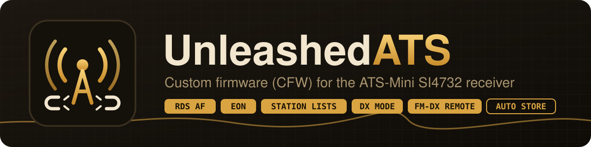
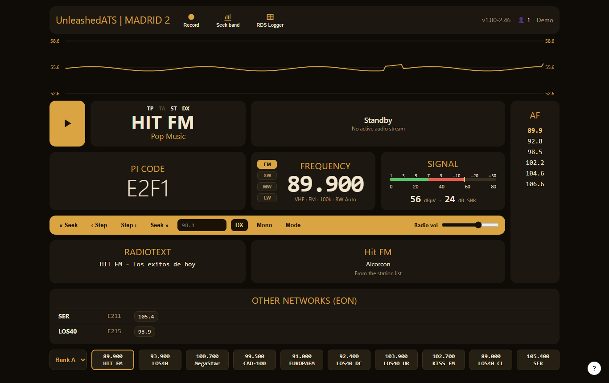
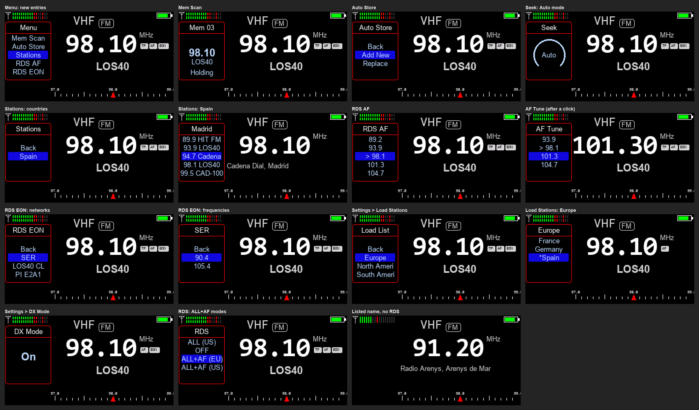
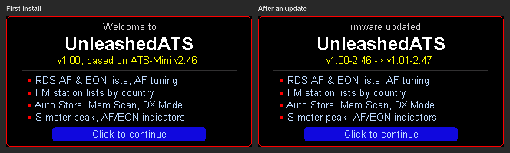

<p align="center">
  
</p>

<p align="center">
  <a href="https://github.com/Danucosukosuko/UnleashedATS/releases/latest"></a>
  
  
  <a href="LICENSE"></a>
</p>

**UnleashedATS** is a custom firmware (CFW) for the ATS-Mini pocket receiver (ESP32-S3 + SI4732). It keeps
everything the [official ATS-Mini firmware](https://github.com/esp32-si4732/ats-mini) does and adds the tools
a DXer misses on the go: RDS alternative frequencies and other networks you can browse and tune, FM station
lists by country that name what you hear even without RDS, band sweeps into memory, a weak signal mode and an
FM-DX style remote control page.

> [!NOTE]
> UnleashedATS is an independent fork. It is not affiliated with or supported by the ATS-Mini maintainers.
> Please report CFW problems [here](https://github.com/Danucosukosuko/UnleashedATS/issues), not upstream.

## What you get

| | Feature | Where |
|---|---|---|
| 📡 | **RDS AF list.** The alternative frequencies of the station, with the one you are on marked. Click one and the encoder moves between them, tuning as it goes. **Back** leaves the list. | Menu → RDS AF |
| 🛰️ | **RDS EON.** The other networks the station announces, with their names and frequencies, ready to tune. | Menu → RDS EON |
| 🔁 | **AF follow.** With `ALL+AF` RDS modes the receiver hops to a stronger frequency of the same programme when reception fades. | Settings → RDS |
| 🚦 | **TP / AF / EON indicators** next to the frequency, and a **peak hold** marker on both S-meters. | Main screen |
| 🗺️ | **FM station lists by country.** Download the list of your country over Wi-Fi, browse it by province or state, and get the stations of your province named on screen when RDS is not there, the way EiBi does it on shortwave. | Settings → Load Stations, Menu → Stations |
| 🎚️ | **Smooth retuning.** Moving through lists, memories and AF frequencies fades the audio instead of clicking the speaker, and long names slide along to be read in full. | Everywhere |
| 🌐 | **DX Watch.** Leave the receiver watching the FM band: it learns your local stations and stops on any new one, the sign of a tropo or sporadic E opening, playing it and logging it. | Menu → DX Watch |
| 💾 | **Auto Store.** Sweeps the band and stores every station it finds, named after its RDS name. **Add New** or **Replace**. | Menu → Auto Store |
| 🔍 | **Mem Scan.** Hops through the memories, skipping the quiet ones and holding on a live channel. | Menu → Mem Scan |
| ⚡ | **Seek Auto.** A third Seek mode that rebuilds the memories from a full band sweep. | Menu → Seek |
| 🌙 | **DX Mode.** No soft mute on weak stations, earlier blend to mono on FM, more sensitive seek, on FM, MW, LW and SW. | Settings → DX Mode |
| 🖥️ | **FM-DX style remote.** A web page at `/remote` with signal history, PS/PI/PTY/RT, AF and EON lists, presets and an RDS logger. | `http://atsmini.local/remote` |
| 🔌 | **Everything over USB.** A JSON monitor with the full receiver state, plus seek, DX and mono commands, for the PC companion. | USB ad hoc protocol |
| 🔄 | **Updates from this repository.** *Settings → Update FW* shows the notes of a new release before installing it, offers a **beta channel**, and goes back to the **previous firmware** with two clicks. | Settings → Update FW |
| 🧰 | **Web updater.** Update from the browser over USB, with the variant detected and the settings kept, and watch and control the receiver live, screen included. | [Web updater](https://danucosukosuko.github.io/UnleashedATS/updater/) |
| 🛟 | **Recovery app.** A recovery app in a partition of its own, out of reach of updates: hold the encoder at power on to start either firmware slot, install a firmware from the browser or GitHub, erase data part by part or go to USB flashing, from the receiver or its own web page. It starts by itself when the firmware is broken, and an update that does not start is rolled back. | Power on |
| 🎨 | **Theme editor.** Make your own color themes in the browser with a live preview on the receiver, and hide the built-in ones you do not use. | `http://atsmini.local/themes` |
| 👋 | **Welcome screen** the first time the firmware runs and after each update. | Boot |

## Fewer restrictions

The official firmware is careful about what goes in: a feature has to suit most users, and many good pull
requests are turned down for being too niche, too experimental or too different. **UnleashedATS is the place
for them.**

* **Had a pull request rejected upstream? Send it here.** DX tools, experimental decoders, unusual hardware
  mods, alternative layouts and power-user settings are all welcome, as long as they build, do not break the
  receiver for everyone else, and can be switched off when they change the default behavior.
* Upstream fixes and features keep flowing in: UnleashedATS is rebased on new ATS-Mini releases, and the
  version name says which one (`v1.00-2.46` is built on ATS-Mini 2.46).
* See [CONTRIBUTING.md](CONTRIBUTING.md) for how to submit.

The firmware itself also lifts limits that the official one keeps on purpose:

| Official firmware | UnleashedATS |
|---|---|
| The `F` frequency command only tunes inside the current band. | `F`, the web remote and the PC companion tune **any frequency**, switching bands by themselves. |
| Weak stations are softly muted by the receiver chip (up to 16 dB on FM). | **DX Mode** turns the soft mute off on FM, MW, LW and SW, so distant stations stay audible. |
| Seek uses fixed signal thresholds. | DX Mode lowers the **seek thresholds**, so seek and Auto Store also stop on weaker stations. |
| On FM, a station without RDS has no name. | Every station in the downloaded **country list** is named on screen, RDS or not. |
| The receiver stays on the frequency you set, even when it fades. | With **AF follow** it moves to a stronger frequency of the same programme. |
| RDS AF and EON data is received and thrown away. | AF and EON are **listed, browsable and tunable**, on the receiver and on the web. |
| Seek has two modes. | A third, **Seek Auto**, rebuilds the memories from a full band sweep. |
| The web interface shows the status and edits settings. | `/remote` gives **live tuning** from any browser, and USB gives the **full receiver state** as JSON. |
| Updates come from the official repository only. | Updates come from this repository, with release notes, a beta channel and a way back to the previous firmware; going back to the official firmware is a normal flash. |
| Holding the encoder at power on erases everything. | It opens a **safe mode** where each kind of data is erased on its own, and the firmware can be recovered. |
| Themes are built into the firmware. | Themes are **made and kept in the browser**, and built-in ones can be hidden. |

Nothing here unlocks transmission or changes the hardware limits of the SI4732: it is still a receiver,
from 150 kHz to 30 MHz and from 64 to 108 MHz.

## Screenshots

<p align="center">
  
  <br><sub>The <code>/remote</code> page. With the <a href="https://github.com/Danucosukosuko/UnleashedATS-Webserver">PC companion</a> it also streams the audio.</sub>
</p>

<p align="center">
  
  <br><sub>The new menus on the receiver.</sub>
</p>

<p align="center">
  
</p>

## Install

1. **Pick your variant.** Receivers with octal PSRAM (most ATS-Mini units, ESP32-S3 N16R8) need **OSPI**.
   Those with quad PSRAM need **QSPI**. If the wrong one is flashed, the receiver boots into a blank screen
   or restarts in a loop; flash the other one. The [flashing guide](docs/source/flash.md) explains how to tell.
2. **Download** `UnleashedATS-<version>-<variant>.zip` from the [latest release](https://github.com/Danucosukosuko/UnleashedATS/releases/latest).
3. **Flash** `ats-mini.ino.merged.bin` at address `0x0` with the
   [Espressif Flash Download Tool](docs/source/flash.md), `esptool` or the ESP Web Flasher:

   ```shell
   esptool --chip esp32s3 --port COM10 --baud 921600 write-flash 0x0 ats-mini.ino.merged.bin
   ```

4. From then on, **Settings → Update FW** installs new UnleashedATS releases over Wi-Fi.

Your settings and memories survive the switch from the official firmware. Going back is just as easy:
flash an official release the same way.

## Versions

Releases are named `v<CFW version>-<ATS-Mini version>`, so `v1.00-2.46` is UnleashedATS 1.00 built on
ATS-Mini 2.46. The receiver shows the same string in *Settings → About*.

## Station lists

The lists live in [`stations/`](stations), one JSON file per country plus `index.json`, and are rebuilt by
[`tools/stations/build_stations.py`](tools/stations/build_stations.py) from open sources: Wikidata (CC0),
Wikipedia station tables (CC BY-SA 4.0), the FCC (public domain) and the REMER vademecum of the Spanish
Civil Protection. Coverage depends on the country; additions are welcome as files in
[`tools/stations/manual/`](tools/stations/manual). See [`stations/README.md`](stations/README.md) for the
format and the licenses.

## Remote control and the PC companion

* **Web:** connect the receiver to Wi-Fi and open `http://atsmini.local/remote`.
* **USB:** enable *Settings → USB Port → Ad hoc*. Besides the [ad hoc commands](docs/source/remote.md),
  `J` toggles a JSON status line every 500 ms, `G`/`g` seek up and down, `X` toggles DX Mode and `Z` toggles mono.
* **[UnleashedATS-Webserver](https://github.com/Danucosukosuko/UnleashedATS-Webserver):** a Python program for
  your PC. It reads the receiver over USB, takes the audio from a line input of your choice and serves the
  same remote page to the internet, with live audio, on the port you configure.

## Building

```shell
arduino-cli compile --profile esp32s3-ospi --warnings all ats-mini
```

The profiles in [`ats-mini/sketch.yaml`](ats-mini/sketch.yaml) pin the ESP32 core and the libraries. After
editing `ats-mini/web/remote.html`, run `python tools/embed_web.py` to update the embedded copy.

## Credits

UnleashedATS is built on the work of the ATS-Mini firmware authors: PU2CLR (Ricardo Caratti), Volos Projects,
Ralph Xavier, Sunnygold, Goshante, G8PTN (Dave), R9UCL (Max Arnold) and Marat Fayzullin. The hardware,
software and flashing documentation of the original project is at <https://esp32-si4732.github.io/ats-mini/>.

The CFW is maintained by [Danucosukosuko](https://github.com/Danucosukosuko).

## License

UnleashedATS is released under the [MIT license](LICENSE), like the official ATS-Mini firmware it is
built on, so features can travel freely between the two. The station lists in [`stations/`](stations) are
distributed under [CC BY-SA 4.0](stations/LICENSE.md), because part of them comes from Wikipedia.
